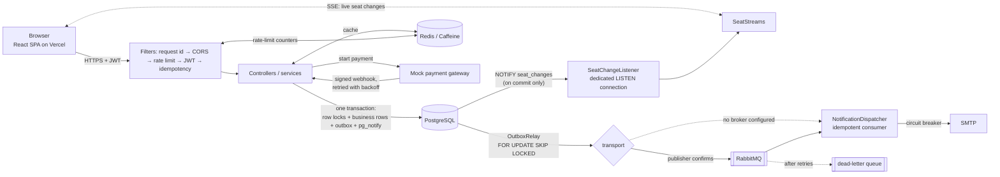

# 🎬 SeatSure

[](https://github.com/MohantyBarun/seatsure/actions/workflows/ci.yml)

A movie ticket booking platform: a **Spring Boot** API and a **React + TypeScript** frontend, deployed on free-tier cloud services.

| | Live |
|---|---|
| 🍿 **App** | **[seatsure-tickets.vercel.app](https://seatsure-tickets.vercel.app)** |
| 📖 **API docs** | [Swagger UI](https://student-service-w3vr.onrender.com/swagger-ui.html) |

> Hosted on free tiers: the backend sleeps when idle, so the first request can take up to a minute.

**👉 Try it without an account:** the sign-in page has **Demo customer** and **Demo admin** buttons. The demo has 8 cinemas in 4 cities, 10 movies and four days of shows, and it resets every night.

## 🎯 The problem

Selling cinema seats is a small but hard concurrency problem:

- **Thousands of people want the same few seats at the same moment** (a blockbuster's first-day evening show). Each seat must go to exactly one person, without double-booking it and without deadlocking the database.
- **Paying takes minutes, and payments arrive late.** A seat has to be reserved while the customer pays, released if they give up, and the bank's confirmation comes back asynchronously, sometimes twice and sometimes after the reservation has lapsed.
- **Everyone looking at the seat map should see it change live**, so nobody picks a seat that was taken a second ago.
- **Sold out shouldn't be the end.** When a seat frees up (an unpaid hold, a cancellation), the next person in line should get it, not whoever refreshes fastest.
- **Emails must match what actually happened.** No ticket email for a rolled-back booking, and no lost email because the mail server was down.

SeatSure solves each of these, and every guarantee is tested against real PostgreSQL.

## 🧭 How a booking works

1. **Browse:** pick a city, a movie, a date and a showtime. This is public, cached, and needs no account.
2. **Pick seats** on a seat map that updates live over Server-Sent Events.
3. **Hold:** the chosen seats are locked and marked held for **10 minutes**. It's all or nothing: if any seat was taken first, nothing is held and the response lists the taken seats.
4. **Pay** on the mock gateway's page ("SeatSure Test Pay": approve or decline).
5. **Webhook:** the gateway sends a signed webhook, retried until acknowledged. The hold becomes a booking, the seats become booked, and a ticket email goes out.
6. **Afterwards:** the customer can cancel up to 2 hours before the show for a refund. Freed seats go to the waitlist first.

Sold-out shows offer a **waitlist**: freed seats are held straight away for the first customer in line whose request fits, and emailed to them with 10 minutes to pay.

## 🏗️ Architecture



### Correctness under concurrency
- **No seat is held twice.** A hold locks its seats with `SELECT … FOR UPDATE` **in seat-id order**, so overlapping requests queue up instead of deadlocking. It then checks that every seat is still available and marks them held, all in one transaction. A competing request waits for the lock, then gets a **409** naming the taken seats.
- **One lock order everywhere:** show (shared) → hold → payment → seats → waitlist entries. Cancelling a show takes the show lock exclusively, so it waits for holds in flight and blocks new ones.
- **Expired holds** are swept every 10 seconds, each in its own transaction. Locking several holds' seats at once would take them out of id order and could deadlock with customers.
- Choosing seats again for the same show replaces your hold: seats you keep stay yours, and the others are freed.
- **Tested with real PostgreSQL:** 30 customers grabbing the same seat at once gives exactly one winner; overlapping multi-seat requests in random order never hold a seat twice and never deadlock; a show cancelled while customers are holding seats ends with nothing held.

### Payments and webhooks
- Starting a payment only registers it with the gateway. The outcome arrives later as a webhook **signed with HMAC-SHA256** (`SeatSure-Signature` header).
- **Exactly-once processing:** the webhook's event id is recorded in the same transaction as its effect. A redelivery is acknowledged and skipped, and a failure rolls both back so the gateway retries.
- The mock gateway retries delivery with exponential backoff (2s, 4s, 8s … capped at 5 minutes). It claims events with a short lease (`SKIP LOCKED`) and makes the HTTP call after that commits, so no row lock is held while waiting on the network.
- **Late or wrong payments are refunded automatically.** If a payment succeeds after its hold lapsed, or for the wrong amount, it's refunded rather than confirmed, and the customer is emailed.

### Live seat map
- Every seat change calls `pg_notify` **inside the transaction that makes it**. PostgreSQL delivers a notification only when its transaction commits, in commit order, and never for one that rolls back. So a seat a customer failed to hold is never shown as taken, and every app instance hears every change.
- Each instance `LISTEN`s on a dedicated connection (not one borrowed from the small free-tier pool) and fans changes out to browsers over **Server-Sent Events** (`GET /shows/{id}/seats/stream`). It reconnects with backoff if that connection drops, then tells every open map to **reload**: notifications sent while it was disconnected are gone for good.
- On shutdown (every deploy) all streams are closed first, so graceful shutdown doesn't wait out its timeout on connections that never finish; browsers reconnect to a live instance by themselves.
- **The client subscribes first, then fetches.** The stream sends `ready`, then the browser fetches the map and replays any events that arrived meanwhile, so no change slips through between the snapshot and the stream. A dropped stream reconnects and refetches.

### Waitlist
- Seats freed by an expired hold or a cancellation are already locked by the transaction that frees them. That same transaction hands them to the oldest waiting customers whose request fits, as a new hold. The public never sees them free in between, and no further locks are taken, so this can't deadlock with customers.

### Reliable emails (transactional outbox)
- Bookings, cancellations, waitlist offers, refunds and sign-ups write an event to `outbox_events` **in the same transaction** as the change. A rolled-back change never sends an email, and an email is never lost because the broker or SMTP was down.
- `OutboxRelay` delivers events right after commit and polls every 30s as a safety net. It **claims** a batch with `FOR UPDATE SKIP LOCKED` and a lease, commits, then **sends with no transaction open** and records each outcome in a short transaction of its own. A slow mail server can't tie up the small connection pool, several instances can relay at once, and a relay that dies mid-send leaves events that come due again when the lease ends. Failures back off exponentially; an event is marked `FAILED` after 10 attempts.
- With `RABBIT_ENABLED=true`, events go through RabbitMQ with publisher confirms, consumer retries and a **dead-letter queue**. Without a broker, the same relay hands events to the consumer in-process.
- **Idempotent consumer:** the message id is recorded in the same transaction as the handling, so a redelivered message sends one email.

### Idempotent APIs
- Holding seats, starting a payment, joining a waitlist, cancelling a booking and the admin create/cancel calls accept an `Idempotency-Key` header (Stripe-style). A retry with the same key replays the original response (`Idempotent-Replayed: true`) instead of acting twice.
  - Same key while the first request is still running: **409**. Same key with a different body: **422**. 5xx responses aren't stored, so they can be retried.
  - The work commits before the response is stored. If an instance dies in between (a deploy), its key would stay "in progress"; after 2 minutes a retry reclaims it and runs again, which is safe because every endpoint re-checks its own state.
- The frontend sends a fresh key per action and retries network failures with the same key, which matters while the free-tier server wakes up.

### Authentication
- 15-minute JWT access tokens, and 7-day **rotating refresh tokens**: random 256-bit values stored only as SHA-256 hashes. Every refresh revokes the old token. If an already-rotated token shows up again, the session was copied (e.g. stolen), so the whole token family is revoked.
- Roles: `ROLE_CUSTOMER` (books) and `ROLE_ADMIN` (runs the cinemas). Browsing is public.
- **Brute-force protection** (`LoginThrottle`): 5 wrong passwords block the account for 30 minutes, and each further one doubles the block, up to a day. It never becomes permanent, since anyone who knows an email address could otherwise lock its owner out for good. Failures older than a day are forgotten, and the counters row is locked during a login so parallel guesses are all counted. BCrypt hashing and a password-strength policy.

### Caching, rate limiting, resilience
- The city home page ("now showing") and the admin dashboard are cached. Redis when `REDIS_ENABLED=true`, Caffeine otherwise. Evictions run after commit, and cache errors fall through to the database.
- **Rate limits** per client IP, using an atomic fixed-window counter (a Redis Lua script or in memory): login 10/min, sign-up 5/min, demo login 20/min, token refresh 30/min, everything else 300/min. Rejected requests get **429** with `Retry-After`. If Redis is down, the limiter fails open behind a circuit breaker.
- **The client IP can't be forged.** Proxies append to `X-Forwarded-For`, so its left end is whatever the client sent. The client is found by counting the trusted proxy hops back from the right (`TRUSTED_PROXIES`; 3 on Render: Cloudflare, Render's edge and its load balancer). `GET /admin/system/client-ip` shows the chain, masked, to check the setting on a new host.
- **Scheduled jobs and several instances:** jobs that claim work with `SKIP LOCKED` (hold expiry, outbox and webhook delivery) share it safely. Jobs that must run once, the demo reset, the startup seed and the nightly purges, take a **ShedLock** lock in PostgreSQL first.
- **The public demo admin** (open to every visitor) sees real customers' names and emails masked; seeded demo accounts stay readable.
- Resilience4j circuit breakers around SMTP and Redis. The health check (`/actuator/health/liveness`) never depends on optional services.

### Observability
- **Metrics** at `/actuator/prometheus` (HTTP Basic, user `metrics`): HTTP latency histograms, JVM/Hikari/cache metrics, `@Observed` timers for logins and seat holds, outbox gauges, rate-limit rejections and circuit-breaker states.
- **Tracing:** Micrometer Tracing with OpenTelemetry. Trace ids appear in every log line, and spans are exported over OTLP when `MANAGEMENT_OTLP_TRACING_ENDPOINT` is set.
- Every response carries `X-Request-Id`. Production logs are JSON (Elastic Common Schema).
- Admin pages show this live: **Emails** shows each notification moving through the outbox (queued, retrying, sent, logged only, failed). **System** shows traffic, cache hit rates, the outbox backlog, rate-limit rejections, circuit breakers and the JVM heap, plus a button that sends wrong logins until the limit answers 429.

### Schema
Flyway owns the schema and Hibernate only validates it, so a mismatched deploy fails at startup instead of altering production tables. The migrations:
- `V1` identity: users, refresh tokens, login security.
- `V2` catalog: cities, cinemas, screens, seats, movies, shows, prices.
- `V3` bookings.
- `V4` outbox, processed messages, notification log, idempotency keys.
- `V5` reference cities.
- `V6` holds, payments, webhook events, waitlist.
- `V7` every timestamp column as `timestamptz` (the code uses `Instant` and one injected `Clock` throughout).
- `V8` ShedLock's lock table.

## 🗂️ Code structure

```
com.seatsure
├── controller/  REST endpoints: thin, validate input and delegate
├── service/     the booking domain: catalogue, holds, bookings, waitlist, admin, auth
├── repository/  Spring Data repositories (JPQL, and native SQL where locking needs it)
├── entity/      JPA entities; state changes are named methods (hold.convertTo, show.cancel), no setters
├── dto/         request/response records per area (CatalogDtos, CheckoutDtos, AdminDtos, ...)
├── payment/     gateway port + mock gateway, webhook verification, refunds
├── outbox/      transactional outbox and its relay
├── messaging/   RabbitMQ transport and consumer (optional)
├── notification/ email composition, sending, idempotent consumer
├── realtime/    LISTEN/NOTIFY listener and SSE fan-out
├── idempotency/ Idempotency-Key filter and store
├── ratelimit/   client IP resolution and rate limiting
├── insights/    the admin Emails and System pages
├── demo/        demo data, the nightly reset, demo-admin privacy
├── config/      security, caching, scheduling locks, time
└── exception/   error types and the JSON error mapping
```

- **Two kinds of package, on purpose.** The booking domain is CRUD-shaped and its services call each other (a booking frees seats to the waitlist), so it is layered: `controller → service → repository`. The infrastructure pieces are self-contained mechanisms with a small surface, so each is a feature package that the domain uses through one class or interface.
- **Swappable boundaries.** Every external dependency sits behind a small interface with implementations chosen by configuration: `PaymentGateway` (mock), `EmailSender` (SMTP, logging-only, allowlist decorator), `OutboxTransport` (in-process, RabbitMQ), `RateLimiter` (in-memory, Redis). The domain never knows which one runs.
- **One responsibility per service.** For example the admin side is `MovieAdminService`, `VenueAdminService` and `ShowScheduleService`, and the lockout policy is `LoginThrottle`, separate from `AuthService`.

## ✅ Features

| | Customer | Admin |
|---|---|---|
| **Browse** | City picker, now showing with language/genre filters, coming soon, movie details, date strip, showtimes by cinema with availability | All movies, cinemas and screens |
| **Book** | Live seat map (Recliner / Prime / Classic), up to 10 seats, 10-minute hold with a countdown, mock payment, ticket with reference | — |
| **After booking** | My bookings, cancel up to 2 hours before for a refund | Latest bookings across all cinemas |
| **Sold out** | Waitlist (1–6 seats), place in line, "Pay now" when seats are offered | — |
| **Manage** | Account, change password | Add/edit movies, add cinemas, build a screen's seat layout (rows, categories, aisles), schedule shows (no overlaps on a screen, plus 15 minutes to clean), cancel a show (every booking refunded and emailed) |
| **Insight** | — | Sales dashboard (today, last 7 days, top movies, busiest shows), Emails, System |

**Frontend:** React 18, TypeScript (strict), Vite, Tailwind CSS. Dark theme with generated posters, accessible dialogs and forms, single-flight token refresh, route guards per role, times always in IST, and a "server is waking up" notice for cold starts.

**Demo mode** (`DEMO_ENABLED=true`): seeds 8 cinemas in Mumbai, Bengaluru, Delhi NCR and Bhubaneswar (two screens each), 10 movies, shows from yesterday to two days ahead, and realistic bookings. Passwordless demo logins mean no credentials are published. `DEMO_RESET_CRON` reseeds around the new day each night.

## 🛠️ Tech stack
- **Backend:** Java 21, Spring Boot 3.4 (Web, Data JPA, Security, Validation), PostgreSQL, Flyway, JWT (jjwt), Redis, RabbitMQ (Spring AMQP), Resilience4j, Spring Mail, Micrometer (Prometheus, OpenTelemetry), springdoc OpenAPI, Lombok, Maven
- **Frontend:** React 18, TypeScript, Vite, React Router, Tailwind CSS ([`frontend/`](frontend))
- **Testing:** JUnit 5, Mockito, MockMvc, Testcontainers (PostgreSQL, RabbitMQ, Redis), Awaitility, JaCoCo; Vitest and Testing Library
- **Infrastructure:** Docker, Docker Compose, GitHub Actions, Render, Neon, Vercel

## 📌 API

Full, interactive docs: **[Swagger UI](https://student-service-w3vr.onrender.com/swagger-ui.html)**. Amounts are in paise.

| Area | Endpoints | Access |
|---|---|---|
| Browse | `GET /cities`, `/cities/{id}/home`, `/movies/{id}`, `/movies/{id}/showtimes?cityId=&date=`, `/shows/{id}`, `/shows/{id}/seats` | Public |
| Live seats | `GET /shows/{id}/seats/stream` (SSE: `ready`, `seats`, `reload`) | Public |
| Checkout | `POST /shows/{id}/holds`, `GET`/`DELETE /holds/{id}`, `POST /holds/{id}/payments`, `POST /mock-gateway/payments/{ref}` | Customer |
| Webhook | `POST /webhooks/payments` (HMAC signature instead of a JWT) | Gateway |
| Bookings | `GET /bookings/me`, `GET /bookings/{ref}`, `POST /bookings/{ref}/cancel` | Customer (admins can view any) |
| Waitlist | `POST /shows/{id}/waitlist`, `GET /waitlist/me`, `DELETE /waitlist/{id}` | Customer |
| Auth | `POST /auth/register`, `/auth/login`, `/auth/refresh`, `/auth/logout`, `/auth/change-password`, `GET /auth/me`, `/auth/demo`, `POST /auth/demo-login` | Mixed |
| Admin | `/admin/dashboard`, `/admin/bookings`, `/admin/movies`, `/admin/cinemas`, `/admin/cinemas/{id}/screens`, `/admin/cinemas/{id}/shows`, `/admin/shows`, `/admin/shows/{id}/cancel`, `/admin/notifications`, `/admin/system` | Admin |

## 🚀 Run locally

**Prerequisites:** Java 21, PostgreSQL (or Docker), Node.js 20+.

```bash
# Backend: demo data on, an admin account seeded in the dev profile (admin@seatsure.dev / Admin@123)
DB_URL=jdbc:postgresql://localhost:5432/seatsure DB_USERNAME=<user> DB_PASSWORD=<password> \
JWT_SECRET=local-dev-secret-that-is-at-least-thirty-two-characters DEMO_ENABLED=true \
./mvnw spring-boot:run

# Frontend
cd frontend
cp .env.example .env.local    # VITE_API_BASE_URL=http://localhost:8080
npm install
npm run dev                   # http://localhost:5173
```

**The whole stack with Docker:** `docker compose up -d` starts PostgreSQL (database, user and password all `seatsure`), Redis, RabbitMQ, Jaeger, Prometheus and Grafana. Then add `REDIS_ENABLED=true RABBIT_ENABLED=true METRICS_PASSWORD=local-metrics MANAGEMENT_OTLP_TRACING_ENDPOINT=http://localhost:4318/v1/traces` to the backend command above.
- RabbitMQ UI: http://localhost:15672 (guest/guest)
- Jaeger: http://localhost:16686
- Prometheus: http://localhost:9090
- Grafana: http://localhost:3001 (admin/admin)

### Environment variables
| Variable | Required | Description |
|---|---|---|
| `JWT_SECRET` | Yes | Random secret, at least 32 characters |
| `DB_URL` / `DB_USERNAME` / `DB_PASSWORD` | Yes | PostgreSQL connection (default URL `jdbc:postgresql://localhost:5432/seatsure`) |
| `SPRING_PROFILES_ACTIVE` | No | `dev` (default) or `prod` |
| `CORS_ALLOWED_ORIGINS` | No | Comma-separated frontend origins (default `http://localhost:5173,http://localhost:3000`) |
| `ADMIN_EMAIL` / `ADMIN_PASSWORD` | Prod | Admin account created on startup if it doesn't exist |
| `DEMO_ENABLED` / `DEMO_RESET_CRON` | No | Seed demo data and enable demo logins; optional cron to reseed (e.g. `0 0 3 * * *`). **The reset wipes the catalogue, bookings and customers** (admins are kept) |
| `PAYMENT_WEBHOOK_SECRET` | No | HMAC key for payment webhooks (default: derived from `JWT_SECRET`) |
| `PAYMENT_WEBHOOK_URL` | No | Where the mock gateway sends webhooks (default: this server) |
| `REALTIME_ENABLED` | No | `false` turns off the live seat stream (default `true`) |
| `REDIS_ENABLED` / `REDIS_URL` | No | Shared cache and rate limits (default: in-process) |
| `RABBIT_ENABLED` / `RABBITMQ_URL` | No | Relay events through RabbitMQ (default: in-process) |
| `SPRING_MAIL_HOST` / `_PORT` / `_USERNAME` / `_PASSWORD` | No | SMTP for real emails (e.g. Brevo). Without it, emails are only logged |
| `MAIL_ALLOWED_RECIPIENTS` | No | Addresses or `@domain`s that get real email. **Required for real email in demo mode**, since visitors can sign up with any address |
| `MAIL_FROM` / `APP_URL` | No | Sender address, and the frontend URL used for links in emails |
| `METRICS_PASSWORD` | No | Enables `/actuator/prometheus` for user `metrics` |
| `MANAGEMENT_OTLP_TRACING_ENDPOINT` | No | OTLP endpoint for traces |
| `DATA_ENCRYPTION_KEY` | No | Base64 32-byte AES key for data encrypted at rest (default: derived from `JWT_SECRET`) |
| `RATE_LIMIT_ENABLED` | No | `false` turns rate limiting off |
| `TRUSTED_PROXIES` | No | Proxies in front of the app that append to `X-Forwarded-For` (default `0` = none; `3` in the prod profile, for Render) |
| `PORT` | No | Default `8080` (set automatically by Render) |

## 🧪 Testing

```bash
./mvnw test                 # backend (integration tests need Docker)
cd frontend && npm test     # frontend
```

CI runs everything on every push and PR, and **fails if any test is skipped**, so integration tests can't silently stop running.

| Area | What's covered |
|---|---|
| Concurrency (Testcontainers PostgreSQL) | 30 customers racing for one seat → one winner; overlapping seat sets → no double holds, no deadlocks; all-or-nothing holds; holds replaced and expired; show cancellation racing holds |
| Payments | Unsigned or forged webhooks refused, redelivered events processed once, a second success for a paid payment ignored, money arriving after the hold lapsed refunded, a wrong amount refunded (exactly what was taken) and never booked |
| Live seat map | A hold shows up on open seat maps and a failed hold never does; a cancelled show tells maps to reload; killing the `LISTEN` connection makes open maps reload once it's back |
| Waitlist | Only for sold-out shows; freed seats offered to the first customer whose request fits, passing to the next if unpaid; cancelled bookings' seats go to the queue |
| Outbox & messaging (PostgreSQL + RabbitMQ) | Emails after commit only, publisher confirms, duplicates processed once, retries then dead-lettering |
| Idempotency, rate limiting, cache (Redis) | Replays, 409/422 conflicts, reclaiming abandoned keys, limits per rule, forged `X-Forwarded-For` sharing the real client's budget, 429 through the real filter chain, fail-open |
| Auth | Token rotation and reuse detection, escalating lockouts that never become permanent, role-based access, demo-admin masking |
| Scheduling | A once-per-cluster job run again inside its lock window is skipped (ShedLock) |
| Frontend | API client (refresh rotation, retries), live seat map hook against a fake `EventSource`, and the booking flow: city picker, seat selection, hold conflicts, waitlist, checkout and webhook polling, cancel, route guards, demo login |

## ☁️ Deployment (free tier)

| Component | Host |
|---|---|
| Backend | [Render](https://render.com) free web service (Docker), from [`render.yaml`](render.yaml) |
| Database | [Neon](https://neon.tech) free PostgreSQL |
| Frontend | [Vercel](https://vercel.com), root directory `frontend/` |

1. **Neon:** create a project near your Render region and copy the **direct** (non-`-pooler`) connection string. The live seat map needs `LISTEN`, which the pooler doesn't support. Split it into `DB_URL=jdbc:postgresql://HOST/DBNAME?sslmode=require`, `DB_USERNAME` and `DB_PASSWORD`.
2. **Render:** **New → Blueprint**, select the repo, and enter the secrets it asks for (`DB_*`, `ADMIN_*`, `CORS_ALLOWED_ORIGINS`). `JWT_SECRET` is generated. Render only redeploys when backend files change.
3. **Vercel:** import the repo with root directory `frontend`, set `VITE_API_BASE_URL` to the Render URL, then add the Vercel URL to `CORS_ALLOWED_ORIGINS` on Render.

Optional free add-ons (everything works without them): [Upstash](https://upstash.com) Redis, [CloudAMQP](https://www.cloudamqp.com) RabbitMQ, [Brevo](https://www.brevo.com) SMTP, and any Prometheus / Grafana Cloud scraper.

## 🔮 Upcoming
- Load test (k6) with published latency numbers for the seat-hold path
